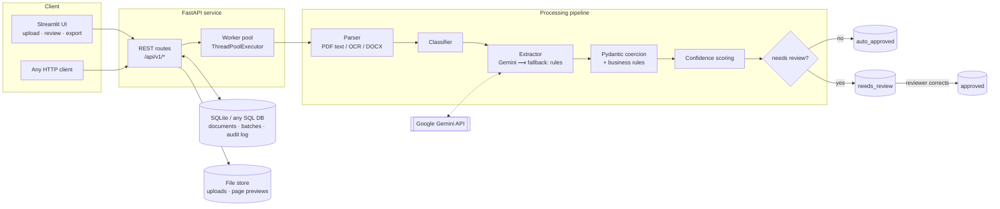
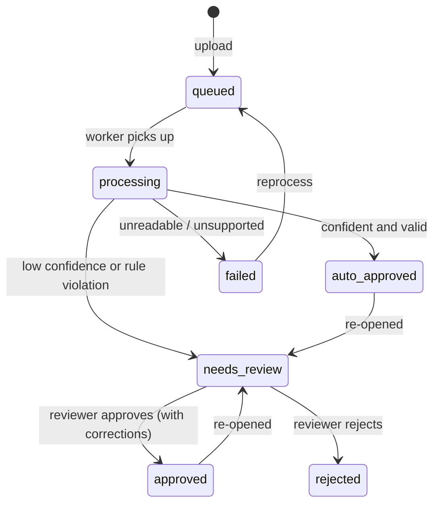

<div align="center">

# 📄 Intelligent Document Processing System

**Turn invoices, receipts, contracts and other business documents into validated, structured data. The pipeline combines OCR, Google Gemini, Pydantic validation, confidence scoring and human review.**

[](https://github.com/MohamedAkramOkasha/Intelligent-Document-Processing-System/actions/workflows/ci.yml)


</div>

---

## Table of contents

- [Overview](#overview)
- [Features](#features)
- [Architecture](#architecture)
- [Quick start](#quick-start)
- [Configuration](#configuration)
- [Using the system](#using-the-system)
- [REST API](#rest-api)
- [How confidence scoring works](#how-confidence-scoring-works)
- [Validation rules](#validation-rules)
- [Exports](#exports)
- [Project structure](#project-structure)
- [Testing](#testing)
- [Extending](#extending)
- [Production notes](#production-notes)
- [Roadmap](#roadmap)

## Overview

Accounts-payable clerks, operations teams and legal assistants spend hours copying values from PDFs and scans into spreadsheets and ERPs. This project automates that work from start to finish:

1. **Ingest** PDFs (digital or scanned), images, DOCX and text files, one at a time or in batches.
2. **Parse**: use the PDF text layer when it exists, and run Tesseract OCR with image pre-processing when it doesn't.
3. **Classify** each document as an invoice, receipt, contract or generic document.
4. **Extract** structured JSON with **Gemini**. The model sees both the OCR text and the original file, and its output must match a strict **Pydantic** schema, with one automatic self-repair round if it doesn't.
5. **Validate** the data with business rules (totals reconcile, dates are consistent, required fields are present, and so on).
6. **Score** confidence for every field and for the whole document, using several independent signals.
7. **Route**: confident documents are auto-approved. Uncertain ones go to a **human-in-the-loop review queue**, where a reviewer sees the original page next to editable, colour-coded fields. Every change is recorded in an audit trail.
8. **Export** approved data to **Excel**, **CSV** or **JSON**.

The system still runs **without an API key**. A rule-based extractor takes over (it is also the automatic fallback when Gemini fails), so you can run the demo, the tests and CI offline.

## Features

| Area | What you get |
|---|---|
| **Document parsing** | PDF text layer via `pypdfium2`, per-page scan detection, Tesseract OCR with grayscale/upscale/denoise/auto-rotate, multi-frame TIFF, DOCX paragraphs + tables, page previews for review |
| **LLM extraction** | Gemini (`google-genai`) in JSON mode, multimodal (PDF/image attached), schema-driven prompts, per-field confidence + verbatim evidence, self-repair on schema errors, retries with exponential backoff |
| **Schemas** | Pydantic v2 models for `Invoice`, `Receipt`, `Contract`, `Generic`; tolerant coercion (`"$1,234.56"` → `1234.56`, `"March 3rd, 2026"` → `2026-03-03`, `"usd"` → `USD`); invalid values are nulled and flagged instead of failing the document |
| **Validation** | Line-item maths, subtotal/tax/total reconciliation, tax-rate maths, due date ≥ issue date, contract expiry > effective date, party count, ISO currency, e-mail format, future/implausible dates |
| **Confidence scoring** | LLM self-assessment, evidence grounding (catches hallucinations) and OCR word confidence, with validation penalties; document score weighted by required fields |
| **Human-in-the-loop** | Review queue sorted least-confident first, side-by-side page preview, 🟢/🟡/🔴 field badges with evidence tooltips, editable line-item tables, change document type, approve / save draft / reject, full audit trail |
| **Batch processing** | Multi-file upload, concurrent worker pool, live progress, per-batch status and export, unfinished jobs resumed on restart |
| **Export** | Styled multi-sheet Excel (summary, per type, line items, validation issues, low-confidence fields, conditional formatting), CSV (per document or per line item), JSON |
| **Deployment** | FastAPI (OpenAPI docs at `/docs`), Streamlit UI, Docker image with Tesseract, docker-compose, optional API-key auth, GitHub Actions CI |

## Architecture



### Document lifecycle



More detail is in [`docs/architecture.md`](docs/architecture.md).

## Quick start

### Option A: Docker (recommended)

```bash
git clone https://github.com/MohamedAkramOkasha/Intelligent-Document-Processing-System.git
cd Intelligent-Document-Processing-System
cp .env.example .env          # add GEMINI_API_KEY (optional but recommended)
docker compose up --build -d
```

| Service | URL |
|---|---|
| Streamlit UI | http://localhost:8501 |
| API + Swagger docs | http://localhost:8000/docs |

Tesseract is already in the image. Data is kept in the `idp-data` volume.

### Option B: Local Python

Requirements: Python 3.11 or newer. For scanned documents you also need [Tesseract](https://tesseract-ocr.github.io/tessdoc/Installation.html) (`apt install tesseract-ocr`, `brew install tesseract`, or the Windows installer).

```bash
python -m venv .venv && source .venv/bin/activate     # Windows: .venv\Scripts\activate
pip install -r requirements-dev.txt
cp .env.example .env                                   # add GEMINI_API_KEY

uvicorn app.api.main:app --reload --port 8000          # terminal 1
streamlit run ui/app.py                                # terminal 2
```

### Try it with sample documents

```bash
python scripts/generate_samples.py      # creates ./samples (PDF invoice, PNG receipt, DOCX contract, ...)
python scripts/smoke_test.py samples    # runs the pipeline directly and prints a summary
```

The samples are fictional. They include `invoice_quickfix_errors.txt`, an invoice whose totals don't add up and whose due date falls before its issue date, so you can watch it go to the review queue.

## Configuration

Settings come from environment variables or `.env`. See [`.env.example`](.env.example) for the full list.

| Variable | Default | Description |
|---|---|---|
| `LLM_PROVIDER` | `gemini` | `gemini`, `groq` (free tier) or `openai` (any OpenAI-compatible API: OpenRouter, Ollama, LM Studio, ...) |
| `GEMINI_API_KEY` | – | Google AI Studio key (provider `gemini`). If no LLM is configured, the rule-based extractor is used |
| `GEMINI_MODEL` | `gemini-3.8-flash` | Any Gemini model that supports JSON output |
| `LLM_API_KEY` | – | Key for `groq` / `openai` (also read from `GROQ_API_KEY` / `OPENAI_API_KEY`) |
| `LLM_MODEL` | `openai/gpt-oss-120b` (groq) | Chat model that supports JSON mode |
| `LLM_BASE_URL` | provider default | Endpoint for `openai`, e.g. `https://openrouter.ai/api/v1` or `http://host.docker.internal:11434/v1` |
| `LLM_VISION` | `false` | Send images to an OpenAI-compatible model (only if it supports vision) |
| `LLM_SEND_FILES` | `true` | Attach the original PDF/image to the prompt (multimodal) |
| `LLM_MAX_RETRIES` | `3` | Retries with exponential backoff for transient errors |
| `OCR_ENABLED` / `OCR_LANGUAGES` | `true` / `eng` | Tesseract settings (`eng+ara+fra` for multilingual) |
| `OCR_DPI` | `300` | Rasterisation DPI for scanned PDF pages |
| `CONFIDENCE_THRESHOLD` | `0.80` | Minimum document score for auto-approval |
| `FIELD_CONFIDENCE_THRESHOLD` | `0.60` | A required field below this sends the document to review |
| `CLASSIFICATION_THRESHOLD` | `0.60` | Minimum document-type confidence |
| `BATCH_CONCURRENCY` | `4` | Parallel workers (keep within your Gemini rate limit) |
| `DATABASE_URL` | SQLite in `DATA_DIR` | Any SQLAlchemy URL, e.g. PostgreSQL |
| `API_KEY` | – | If set, `/api/v1/*` requires the `X-API-Key` header |

## Using the system

**Upload & Process**: drop in one file for immediate processing, or several files to start a batch with a live progress bar. You can let the system detect the document type or set it yourself.

**Review Queue**: documents are listed least-confident first. For each one you get:
- the rendered pages (or the extracted text) on the left;
- every field on the right with a confidence badge: 🟢 ≥ 80 %, 🟡 60–80 %, 🔴 < 60 %. Hover over a field to see its signal breakdown (LLM / grounding / OCR), the supporting snippet from the document, and any rule violations;
- line items, parties and key-values as editable tables, where you can add or delete rows;
- **Approve**, **Save draft** or **Reject**. Saving re-runs validation and scoring right away.

**Documents**: search and filter all documents, see the original extraction next to the corrected data, download the source file, reprocess, re-open for review, or delete.

**Batches** and **Export**: track batch progress, then download Excel, CSV or JSON filtered by status, type or batch.

## REST API

Interactive documentation is at **`/docs`** (Swagger) and **`/redoc`**.

| Method | Endpoint | Purpose |
|---|---|---|
| `GET` | `/health` | Liveness + LLM/OCR availability |
| `GET` | `/api/v1/stats` | Counts by status/type, average confidence, auto-approval rate |
| `POST` | `/api/v1/documents` | Upload one document (`?wait=false` to queue it instead) |
| `GET` | `/api/v1/documents` | List documents (`status`, `document_type`, `batch_id`, `q`, paging) |
| `GET` | `/api/v1/documents/{id}` | Full detail: extracted/corrected data, field confidences, issues |
| `GET` | `/api/v1/documents/{id}/file` | Original file |
| `GET` | `/api/v1/documents/{id}/pages/{n}` | Rendered page preview (PNG) |
| `POST` | `/api/v1/documents/{id}/reprocess` | Re-run extraction (optionally with a forced type) |
| `DELETE` | `/api/v1/documents/{id}` | Delete document and files |
| `GET` | `/api/v1/review/queue` | Documents awaiting review |
| `POST` | `/api/v1/review/{id}` | Submit corrections and approve or save |
| `POST` | `/api/v1/review/{id}/approve` · `/reject` | Approve as-is / reject |
| `GET` | `/api/v1/review/{id}/history` | Audit trail |
| `POST` | `/api/v1/batches` | Upload many files and process them concurrently |
| `GET` | `/api/v1/batches[/{id}]` | Batch progress and documents |
| `GET` | `/api/v1/export` | `format=xlsx\|csv\|json`, `status`, `document_type`, `batch_id`, `dataset=documents\|line_items` |

### Examples

```bash
# Process an invoice synchronously
curl -F "file=@samples/invoice_nimbus.pdf" http://localhost:8000/api/v1/documents

# Batch upload
curl -F "files=@a.pdf" -F "files=@b.png" -F "name=October AP" http://localhost:8000/api/v1/batches

# Correct two fields and approve
curl -X POST http://localhost:8000/api/v1/review/<id> -H "Content-Type: application/json" \
  -d '{"corrections": {"total_amount": 1278.00, "vendor.name": "Nimbus Cloud Solutions Ltd"},
       "reviewer": "alice", "comment": "fixed OCR error", "approve": true}'

# Export all approved invoices to Excel
curl -o invoices.xlsx "http://localhost:8000/api/v1/export?format=xlsx&document_type=invoice"
```

<details>
<summary>Example extraction result (abridged)</summary>

```json
{
  "document_type": "invoice",
  "classification_confidence": 0.98,
  "overall_confidence": 0.93,
  "needs_review": false,
  "data": {
    "invoice_number": "INV-2026-0042",
    "invoice_date": "2026-10-01",
    "due_date": "2026-10-31",
    "vendor": { "name": "Nimbus Cloud Solutions Ltd.", "tax_id": "GB123456789" },
    "customer": { "name": "Orbital Analytics GmbH" },
    "currency": "GBP",
    "line_items": [
      { "description": "Cloud hosting - Standard plan", "quantity": 3, "unit_price": 120.0, "amount": 360.0 }
    ],
    "subtotal": 1065.0, "tax_rate": 20.0, "tax_amount": 213.0, "total_amount": 1278.0
  },
  "fields": [
    { "path": "total_amount", "value": 1278.0, "confidence": 0.98,
      "llm_confidence": 0.99, "evidence_score": 1.0, "evidence": "Total (GBP) 1,278.00",
      "required": true, "needs_review": false, "issues": [] }
  ],
  "validation_issues": [],
  "extractor": "gemini:gemini-3.8-flash"
}
```
</details>

## How confidence scoring works

LLM self-reported confidence alone is poorly calibrated, so each field's score blends **independent signals** (`app/processing/confidence.py`):

| Signal | Weight | What it measures |
|---|---|---|
| LLM self-assessment | 0.45 | The model's per-field confidence, anchored by a rubric in the prompt |
| Evidence grounding | 0.35 | Whether the value actually appears in the document: format-aware for numbers (`1278` ↔ `1,278.00`) and dates (`2026-03-03` ↔ `March 3, 2026`), fuzzy matching for text. **This is what catches hallucinations.** |
| OCR quality | 0.20 | Mean Tesseract confidence of the words supporting the value (scanned documents only) |

Signals that don't apply (for example OCR on a digital PDF) are left out and the remaining weights are re-normalised. A rule violation then multiplies the score of every field it touches (×0.5 for errors, ×0.85 for warnings).

**Document score** = `0.6 × weighted mean (required fields ×3) + 0.4 × weakest required field`, scaled by classification confidence.

A document goes to review if **any** of the following is true:
- document score < `CONFIDENCE_THRESHOLD`;
- a required field < `FIELD_CONFIDENCE_THRESHOLD` (or missing);
- any validation **error**;
- document type uncertain;
- the rule-based fallback was used while an LLM is configured.

When a reviewer approves a document, every field is marked `human_verified` with confidence 1.0.

## Validation rules

| Type | Rules |
|---|---|
| All | required fields, ISO-4217 currency, e-mail format |
| Invoice / Receipt | `qty × unit_price = amount` per line · Σ line items = subtotal · subtotal + tax + shipping + tip − discount = total (tax-inclusive totals accepted) · tax-rate maths · non-negative total |
| Invoice | due date ≥ invoice date · no future or implausible (< 1990) dates · amount due ≤ total |
| Receipt | no future transaction date |
| Contract | expiration > effective date · at least 2 named parties · non-negative value |

Tolerance: `max(0.02, 0.5 %)` of the amount, so rounding differences don't raise flags.

## Exports

**Excel** (`.xlsx`) has these sheets, all with styled headers, frozen panes, auto-filter and red/amber/green confidence formatting:

| Sheet | Contents |
|---|---|
| Summary | One row per document: type, status, confidence, reference, date, counterparty, total, reviewer |
| Invoices / Receipts / Contracts / Other | All fields, flattened (`vendor.name`, `parties[0].role`, …) |
| Line Items | One row per line item across all documents |
| Validation Issues | Every rule violation |
| Low Confidence Fields | Unverified fields below the field threshold |

**CSV**: `dataset=documents` gives one row per document with every field; `dataset=line_items` gives one row per line item. Files are UTF-8 with a BOM so Excel opens them correctly.
**JSON**: final data plus validation issues.

Exports include only `approved` and `auto_approved` documents unless you pass `status`.

## Project structure

```
├── app/
│   ├── api/                 # FastAPI app, dependencies, routes (documents, review, batches, export, system)
│   ├── processing/
│   │   ├── parsers.py       # PDF / image / DOCX / text → pages + previews
│   │   ├── ocr.py           # Tesseract wrapper, pre-processing, word confidences
│   │   ├── llm.py           # Gemini client (JSON mode, multimodal, retries)
│   │   ├── prompts.py       # classification / extraction / repair prompts
│   │   ├── extractors.py    # GeminiExtractor, HeuristicExtractor
│   │   ├── heuristics.py    # rule-based classifier + extractors (offline / fallback)
│   │   ├── validation.py    # Pydantic coercion + business rules
│   │   ├── confidence.py    # multi-signal confidence scoring + review routing
│   │   └── pipeline.py      # orchestration
│   ├── schemas/             # Pydantic models: document types, extraction result, API I/O
│   ├── services/            # document lifecycle, review, batches, export
│   ├── storage/             # SQLAlchemy models & session
│   ├── config.py            # pydantic-settings configuration
│   └── utils.py             # number/date parsing, nested-path helpers
├── ui/                      # Streamlit app (dashboard, upload, review, documents, batches, export)
├── tests/                   # pytest suite (fake Gemini client, no network)
├── scripts/                 # sample generator, smoke test
├── docs/architecture.md
├── Dockerfile · docker-compose.yml · Makefile · pyproject.toml
└── .github/workflows/ci.yml
```

## Testing

```bash
pytest                    # 40 tests: parsing, coercion, validation, scoring, LLM paths, API, export
pytest --cov=app          # with coverage
ruff check app ui tests scripts
```

The LLM paths are tested with a **fake Gemini client** (`tests/conftest.py`). The tests cover confident auto-approval, hallucinated totals being caught, the schema self-repair round, and falling back to the rule-based extractor when the API fails. None of them make network calls.

## Extending

**Add a document type** (for example a purchase order):
1. Add a Pydantic model and register it in `DOCUMENT_MODELS`, `REQUIRED_FIELDS` and `SUMMARY_FIELDS` (`app/schemas/documents.py`).
2. Add a `DocumentType` value and an extraction hint in `prompts.py`.
3. Optionally add business rules in `validation.py` and a heuristic extractor.

The UI and exports pick up new fields automatically.

**Swap the LLM**: implement the `Extractor` protocol (`classify` and `extract`) and pass it to `DocumentPipeline(extractor=...)`.

## Production notes

- **Scaling**: the worker pool runs inside the API process, so run uvicorn with **one worker per container** and scale by adding containers with a shared PostgreSQL `DATABASE_URL` and shared storage. For heavy workloads, move `process_document` to Celery/RQ/Arq; it is already a standalone, idempotent function.
- **Security**: set `API_KEY`, restrict `CORS_ORIGINS`, and put the services behind TLS. Uploaded documents may contain personal data, so encrypt the data volume and set a retention policy.
- **Cost control**: `LLM_SEND_FILES=false` sends text only. Classification attaches the file only when there's too little text to decide from. A forced `document_type` skips the classification call entirely.

## Roadmap

- [ ] Bounding-box highlighting of extracted values on the page preview
- [ ] Active learning: use reviewer corrections as few-shot examples
- [ ] Duplicate-invoice detection (file hash already stored)
- [ ] Webhooks / e-mail ingestion
- [ ] Role-based access control for reviewers

## License

[MIT](LICENSE)
