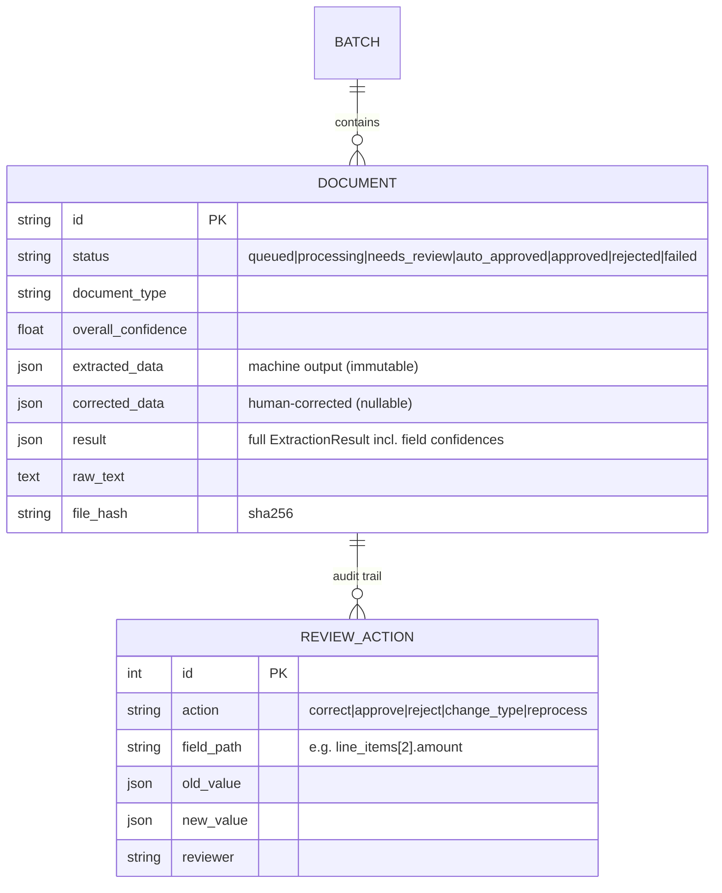

# Architecture

## Design goals

1. **Correct over fast.** A wrong number in an ERP costs more than a minute of a reviewer's time. The system is built to *know when it doesn't know*.
2. **Never fail a whole document over one bad value.** An unparseable date is set to null and flagged. It doesn't throw away twenty good fields.
3. **Degrade gracefully.** If there is no API key, the LLM provider's quota runs out (and no fallback provider is left), Tesseract is missing or a PDF is scanned, there is always a fallback path, and the reason is recorded in `warnings` and `review_reasons`.
4. **Auditable.** The original extraction, the human correction and who changed what are all kept.

## Components

| Layer | Module | Responsibility |
|---|---|---|
| Interface | `ui/` (Streamlit) | Upload, review, browse, export. Talks only to the REST API |
| API | `app/api` (FastAPI) | Validation of requests, auth (`X-API-Key`), OpenAPI docs |
| Services | `app/services` | Document lifecycle, worker pool, review logic, export building |
| Pipeline | `app/processing` | Stateless: bytes in, `ExtractionResult` out |
| Storage | `app/storage` | SQLAlchemy models: `documents`, `batches`, `review_actions` |

The pipeline knows nothing about HTTP or databases. You can call `DocumentPipeline().process(bytes, filename)` from a notebook, a CLI (`scripts/smoke_test.py`) or a queue worker.

## Processing pipeline

```
bytes ─► parse_document ─► ParsedDocument(pages, ocr_words, preview_images)
            │  PDF: text layer per page; pages with < MIN_TEXT_CHARS_PER_PAGE chars are rasterised at OCR_DPI → OCR
            │  Image: EXIF-transpose → grayscale → upscale → autocontrast → median → sharpen → OSD rotate → OCR
            │  DOCX: paragraphs + tables (merged cells de-duplicated)
            ▼
       classify ─► (DocumentType, confidence)          LLM, or keyword scoring as fallback
            ▼
        extract ─► RawExtraction(data, field_confidence, evidence)
            │  LLM JSON mode (Gemini, Groq or any OpenAI-compatible API), prompt = JSON Schema of the Pydantic model + rubric + text (+ file)
            │  if data fails schema validation → one repair round with the error list
            │  any exception → HeuristicExtractor
            ▼
         coerce ─► Pydantic model_validate; invalid leaves nulled one by one and reported
            ▼
       validate ─► business rules → ValidationIssue(field, rule, severity, message)
            ▼
          score ─► FieldConfidence per leaf + document score + review reasons
```

## Data model



`final_data = corrected_data ?? extracted_data` is what the UI shows and what gets exported.

## Review flow

1. A reviewer submits either a full `data` object or `{path: value}` corrections.
2. The server diffs the old and new data (as flattened paths) and writes one `ReviewAction` per changed field.
3. The data is coerced and validated again, then re-scored. Changed fields, or all fields on approval, become `human_verified` with confidence 1.0.
4. The status becomes `approved`, or stays `needs_review` for a saved draft.

## Concurrency

Uploads are stored and committed straight away. Processing runs on a `ThreadPoolExecutor` (`BATCH_CONCURRENCY`) with one DB session per job, and SQLite runs in WAL mode with a busy timeout. Batch progress is computed from document statuses rather than counters, so concurrent workers never race on a shared row. When the app starts, it re-queues any documents still marked `queued` or `processing`.
